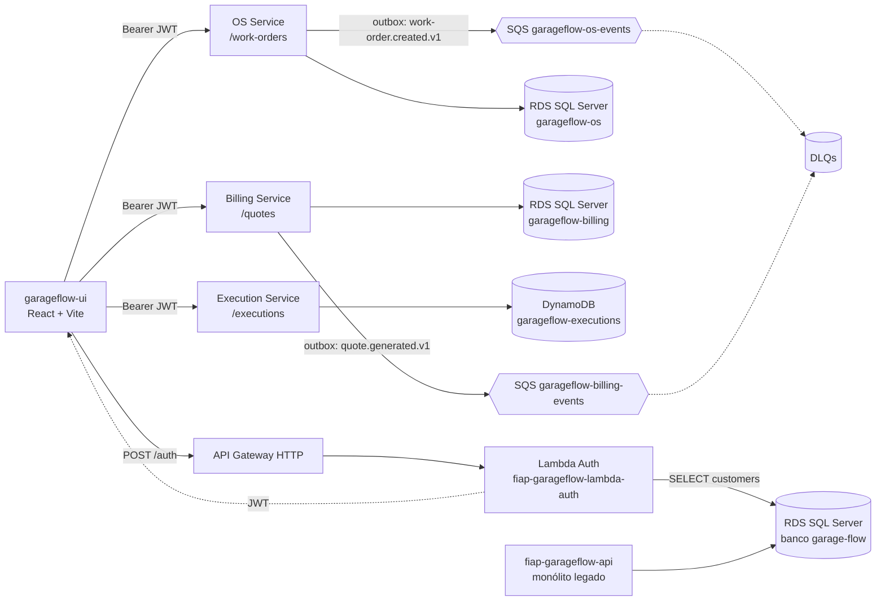

# fiap-garageflow-api

Monólito original do GarageFlow (oficina mecânica): API .NET 8 em Clean Architecture para clientes, veículos, serviços, peças e ordens de serviço (OS).

> **Status no Tech Challenge Fase 4: legado / referência de domínio.**
> A arquitetura-alvo é composta por microsserviços (`garageflow-os-service`, `garageflow-billing-service`, `garageflow-execution-service`) e este monólito é a **origem da refatoração**. Seus workflows e manifests ainda existem e ainda implantam esta API (ver [Status de implantação](#status-de-implantação-do-monólito)), por isso ele não foi removido. Detalhes em [Visão geral da solução](#visão-geral-da-solução) e em [Status e pendências](#status-e-pendências).

## Sumário

- [Visão geral da solução](#visão-geral-da-solução)
- [Decisão arquitetural: microsserviços e Saga](#decisão-arquitetural-microsserviços-e-saga)
- [Mapeamento do domínio do monólito para os microsserviços](#mapeamento-do-domínio-do-monólito-para-os-microsserviços)
- [Estrutura do projeto](#estrutura-do-projeto)
- [Stack](#stack)
- [Configuração](#configuração)
- [Execução local](#execução-local)
- [Endpoints do monólito](#endpoints-do-monólito)
- [Testes e qualidade](#testes-e-qualidade)
- [CI/CD](#cicd)
- [Mapa de requisitos do Tech Challenge](#mapa-de-requisitos-do-tech-challenge)
- [Status e pendências](#status-e-pendências)
- [Troubleshooting](#troubleshooting)
- [Documentação adicional](#documentação-adicional)

## Visão geral da solução

Organização GitHub: `https://github.com/FiapPosEAA/<repositório>`.



Legenda: setas tracejadas para DLQ indicam a política de redrive definida em Terraform. Hoje os eventos são publicados no SQS, mas nenhum serviço consome mensagens (ver [Status e pendências](#status-e-pendências)). O monólito acessa o mesmo banco `garage-flow` que a Lambda consulta.

| Repositório | Papel | Tecnologia |
|---|---|---|
| `fiap-garageflow-api` (este) | Monólito legado/referência; origem do domínio | .NET 8, EF Core, SQL Server |
| `garageflow-os-service` | Abertura/consulta de OS; futuro orquestrador da Saga | .NET 8, SQL Server, SQS |
| `garageflow-billing-service` | Orçamento (`quotes`); futuro pagamento (Mercado Pago) | .NET 8, SQL Server, SQS |
| `garageflow-execution-service` | Fila/execução da OS | .NET 8, DynamoDB |
| `fiap-garageflow-lambda-auth` | Login por CPF e emissão de JWT | Node.js 20, API Gateway HTTP |
| `fiap-garageflow-db-infra` | VPC, RDS SQL Server (uma instância) | Terraform |
| `fiap-garageflow-k8s-infra` | VPC, EKS (`garage_flow_eks`), IAM de SQS/DynamoDB para os nodes, manifests do monólito | Terraform, Kubernetes |
| `garageflow-ui` | Interface de demonstração do fluxo | React, TypeScript, Vite |

## Decisão arquitetural: microsserviços e Saga

O monólito concentra cliente, veículo, catálogo, OS e orçamento em um único banco e processo. Na Fase 4 ele é decomposto em três serviços com banco próprio (SQL Server para OS e Billing, DynamoDB para Execution), comunicando-se por eventos no Amazon SQS.

**Saga orquestrada (orquestrador no OS Service).** Orquestração em vez de coreografia, pelos motivos:

- controle central do fluxo da OS: abertura → orçamento → aprovação → execução → finalização;
- compensação em caso de falha (por exemplo, pagamento rejeitado ou falha na execução cancela a OS), decidida em um único ponto;
- rastreabilidade mais simples (`correlationId` = id da OS, já presente nos payloads dos eventos), útil para o vídeo de demonstração.

**Trade-off.** O orquestrador é um ponto único de coordenação. A mitigação é o padrão **outbox + SQS com DLQs**: o evento é gravado na mesma transação da OS (tabela `OutboxMessages`) e publicado por um dispatcher em segundo plano; as filas `garageflow-{os,billing,execution}-events` têm DLQ com `maxReceiveCount = 5` (`garageflow-os-service/infra/sqs/main.tf`).

> Estado real: outbox e DLQs existem no código/IaC; o orquestrador (consumo de eventos, transições e compensação) **ainda não foi implementado**. Ver checklist.

## Mapeamento do domínio do monólito para os microsserviços

| Conceito do monólito | Onde está no monólito | Destino na arquitetura-alvo | Situação verificada no código |
|---|---|---|---|
| Cliente (`Customer`, CPF único) | `Domain/Entities/Customer.cs`, `CustomersController` | Sem serviço dono definido; a Lambda Auth lê a tabela `customers` do banco `garage-flow` | Ainda dependente do banco do monólito |
| Veículo (`Vehicle`) | `VehiclesController` | OS Service recebe apenas `vehicleId` (texto) | Dados do veículo não migrados |
| Catálogo de serviços e peças (`Service`, `Part`) | `ServicesController`, `PartsController` | Sem serviço dono (OS/Billing não possuem catálogo) | Não migrado |
| Abertura/consulta da OS (`WorkOrder`, status `Received`) | `WorkOrdersController` | `garageflow-os-service`: `POST /work-orders` (status inicial `PendingBilling`) | Parcial: sem descrição, itens ou número da OS |
| Orçamento (`GenerateBudget`, `TotalAmount`, `ResolveBudget`) | `WorkOrder.cs`, `/budget`, `/budget/decision` | `garageflow-billing-service`: `POST /quotes` (status `PendingApproval`, valor informado pelo chamador) | Parcial: sem cálculo a partir de itens; sem endpoint de aprovação |
| Status `Diagnosis`, `InProgress`, `Finished`, `Delivered` | `WorkOrderStatus` | `garageflow-execution-service`: `POST /executions` (status `Queued`) | Parcial: só enfileira |
| Cancelamento (`Canceled`) | `WorkOrderStatus` | Compensação da Saga no OS Service | Não implementado |
| Autenticação CPF → JWT | Lambda (o monólito só valida o JWT) | `fiap-garageflow-lambda-auth` | Implementado |

Status do monólito (enum): `Received=1, Diagnosis=2, WaitingApproval=3, InProgress=4, Finished=5, Delivered=6, Canceled=7`.

## Estrutura do projeto

```text
fiap-garageflow-api/
├── Dockerfile                      # build multi-stage .NET 8, porta 8080
├── .github/workflows/
│   ├── ci.yml                      # restore, build, test
│   └── cd.yml                      # imagem no GHCR + deploy no EKS
├── docs/
│   ├── architecture.md
│   ├── operations.md
│   ├── adr/0001-use-jwt-with-cpf-authentication.md
│   └── rfcs/rfc-001-cloud-and-platform.md
└── src/
    ├── GarageFlowService.slnx
    ├── GarageFlowService.API/             # controllers, Program.cs, middleware, Swagger
    ├── GarageFlowService.Application/     # casos de uso (MediatR), DTOs
    ├── GarageFlowService.Domain/          # entidades, enums, interfaces
    ├── GarageFlowService.Infrastructure/  # EF Core, repositórios, migrations
    └── tests/GarageFlowService.Tests/     # xUnit
```

## Stack

- .NET 8, ASP.NET Core Web API, MediatR 12.4.1, FluentValidation 11.11.0
- Entity Framework Core 8.0.11 (SQL Server); migrations aplicadas na inicialização (`MigrateAsync`)
- JWT Bearer (`Microsoft.AspNetCore.Authentication.JwtBearer` 8.0.11) e Swagger (Swashbuckle 7.3.1)
- Docker e Kubernetes (EKS)

## Configuração

O `appsettings.json` traz valores vazios para `ConnectionStrings:DefaultConnection` e `Jwt:Key`; defina-os por variáveis de ambiente.

| Variável | Obrigatória | Descrição |
|---|:---:|---|
| `ConnectionStrings__DefaultConnection` | Sim | Connection string do SQL Server (banco `garage-flow`) |
| `Jwt__Key` | Sim | Chave de validação do JWT (a API falha ao iniciar sem ela) |
| `Jwt__Issuer` | Sim | Padrão no `appsettings.json`: `GarageFlowService` |
| `Jwt__Audience` | Sim | Padrão no `appsettings.json`: `GarageFlowServiceClients` |
| `ASPNETCORE_URLS` | Não | No Kubernetes: `http://+:8080` (ConfigMap) |

Nunca versione valores de connection string ou chave JWT. No Kubernetes o Secret `garage-flow-secrets` guarda `ConnectionStrings__DefaultConnection` e `Jwt__Key`.

## Execução local

Pré-requisitos: .NET 8 SDK, SQL Server acessível e uma chave JWT.

```powershell
cd src
dotnet restore GarageFlowService.slnx
$env:ConnectionStrings__DefaultConnection = "<connection-string-sql-server>"
$env:Jwt__Key = "<chave-com-no-minimo-32-caracteres>"
dotnet run --project GarageFlowService.API/GarageFlowService.API.csproj
```

- Swagger: `https://localhost:7129/swagger` (perfil `https` de `launchSettings.json`).
- Health check: `/health`.
- As migrations são aplicadas automaticamente na subida.

### Docker

```powershell
docker build -t garageflow-api .
docker run --rm -p 8080:8080 `
    -e ConnectionStrings__DefaultConnection="<connection-string-sql-server>" `
    -e Jwt__Key="<chave-jwt>" `
    garageflow-api
```

Swagger em `http://localhost:8080/swagger`.

### Autenticação

A API **não possui endpoint de login**. O JWT é emitido pela Lambda (`POST /auth` no API Gateway, corpo `{"cpf": "..."}`) e enviado em `Authorization: Bearer <token>`. A API valida emissor, audiência, expiração e assinatura.

## Endpoints do monólito

Prefixo `api/[controller]`. Rotas marcadas com `*` exigem JWT (`[Authorize]`).

| Recurso | Rotas |
|---|---|
| `customers` | `GET`, `GET {id}`, `POST`*, `PUT {id}`* |
| `vehicles` | `GET customer/{customerId}`, `POST`* |
| `services` | `GET`, `POST`* |
| `parts` | `GET`, `POST`*, `PATCH {id}/stock`* |
| `workorders` | `GET`, `GET {id}`, `GET {id}/status`, `GET {id}/budget`, `POST`*, `PATCH {id}/status`*, `POST {id}/services`*, `POST {id}/parts`*, `POST {id}/status/notification` (anônima), `POST {id}/budget/decision` (anônima) |

## Testes e qualidade

```powershell
dotnet test src/tests/GarageFlowService.Tests/GarageFlowService.Tests.csproj --nologo
```

- xUnit, Moq, FluentAssertions e EF Core InMemory (`coverlet.collector` referenciado).
- Encontrados 131 métodos `[Fact]` em 31 arquivos: domínio, casos de uso (Application) e repositórios com banco InMemory.
- Os testes **não** foram executados na elaboração deste README; a cobertura não foi medida e não há gate de cobertura nem análise estática (por exemplo SonarQube) nos workflows.
- Os microsserviços ainda não possuem projeto de teste (seus CIs só executam testes se existir um).

## CI/CD

| Workflow | Gatilho | O que faz |
|---|---|---|
| `ci.yml` | push e PR em `main` | `dotnet restore`, `build` e `test` em `src/GarageFlowService.slnx` (.NET 8) |
| `cd.yml` | push em `main` e `homologacao` | Ambiente GitHub `producao` (main) ou `homologacao`; build/push de `ghcr.io/<owner>/garageflow-api:<sha>`; `aws eks update-kubeconfig`; recria o Secret `garage-flow-secrets`; `kubectl set image` em `garage-flow-deployment`; aguarda o rollout (180 s) |

Secrets do GitHub (somente nomes): `AWS_ACCESS_KEY_ID`, `AWS_SECRET_ACCESS_KEY`, `DEFAULT_CONNECTION`, `JWT_SECRET`.
Variables: `AWS_REGION` (padrão `us-east-2`), `EKS_CLUSTER_NAME`.

Proteção de branches e Environments são configurações do GitHub (ver [docs/operations.md](docs/operations.md)) e não são verificáveis pelos workflows.

### Status de implantação do monólito

Pelo código, o monólito **ainda é implantável e é implantado pelo CD** deste repositório:

- `fiap-garageflow-k8s-infra/k8s/` define `garage-flow-deployment` (porta 8080, probes em `/health`), ConfigMap, HPA de 1 a 2 réplicas e um Service `LoadBalancer` (NLB, `internet-facing`) na porta 80, no namespace `garage-flow-namespace`.
- O workflow do `fiap-garageflow-k8s-infra` executa apenas Terraform; os manifests `k8s/` são aplicados manualmente (README daquele repositório) e o `cd.yml` deste repositório atualiza imagem e Secret.
- Os três microsserviços usam o mesmo namespace, com Services `ClusterIP` (sem exposição externa por manifesto) e imagem `ghcr.io/fiapposeaa/garageflow-<serviço>:latest`.
- O README do `fiap-garageflow-k8s-infra` descreve apenas a API do monólito.

Não foi possível verificar o que está efetivamente rodando na AWS; isso exige consulta ao cluster.

## Mapa de requisitos do Tech Challenge

Lista construída a partir do escopo da Fase 4 descrito para o projeto e do que foi encontrado nos repositórios (não é transcrição do enunciado oficial).

| Requisito | Onde está | Status |
|---|---|---|
| Decomposição em microsserviços (OS, Billing, Execution) | `garageflow-os-service`, `garageflow-billing-service`, `garageflow-execution-service` | Parcial: contrato mínimo (`POST`/`GET`), sem as regras do monólito |
| Saga orquestrada no OS Service | `garageflow-os-service` | Pendente: só há o estado inicial `PendingBilling` e o evento `work-order.created.v1`; sem consumidor, transições ou compensação |
| Mensageria SQS | `garageflow-os-service/infra/sqs`; `SqsOutboxDispatcher` em OS e Billing | Parcial: publicação por outbox em OS e Billing; Execution não publica; nenhum serviço consome |
| DLQs | `infra/sqs/main.tf` (`maxReceiveCount = 5`, retenção de 14 dias) | Implementado em IaC; provisionamento manual via workflow `Provision SQS` (aplicação não verificada) |
| Outbox transacional | `OsDbContext`, `BillingDbContext` (`OutboxMessages`) | Implementado em OS e Billing; inbox/idempotência de consumo pendentes |
| SQL Server (RDS) por serviço | `fiap-garageflow-db-infra` (instância única; bancos lógicos `garageflow-os` e `garageflow-billing`) | Parcial: bancos lógicos criados manualmente (o Terraform não os cria) |
| DynamoDB no Execution | `garageflow-execution-service/infra/dynamodb`, `ExecutionStore` | Implementado (tabela `garageflow-executions`, chave `id`); provisionamento manual via workflow |
| Autenticação CPF → JWT | `fiap-garageflow-lambda-auth` | Implementado; ver inconsistências de `aud` e CORS em [Status e pendências](#status-e-pendências) |
| Kubernetes/EKS | `fiap-garageflow-k8s-infra/terraform`, `k8s/` de cada serviço | Parcial: manifests por serviço existem; k8s-infra ainda descreve só o monólito |
| IaC (Terraform) | `db-infra`, `k8s-infra`, `lambda-auth`, SQS e DynamoDB nos serviços | Implementado |
| CI/CD | `.github/workflows` nos repositórios | Parcial: CI dos serviços sem testes; UI sem workflow |
| Testes automatizados | `src/tests/GarageFlowService.Tests` (monólito) | Parcial: 131 `[Fact]` no monólito; nenhum nos microsserviços; cobertura não medida |
| Pagamento (Mercado Pago) | `garageflow-billing-service` | Pendente: apenas descrito no README do serviço; não há código |
| Interface para demonstração | `garageflow-ui` | Parcial: chama `POST /quotes/{id}/approve`, inexistente no Billing |
| Documentação (ADR/RFC) | `docs/` | Parcial: histórico do monólito + seção de migração; sem ADR da Saga |
| Vídeo de demonstração | — | Não verificável pelo repositório |

## Status e pendências

- [x] Monólito .NET 8 com Clean Architecture, JWT e migrations (histórico/referência)
- [x] Esqueleto dos três microsserviços com JWT, `/health`, Dockerfile, k8s, HPA e CD para o EKS
- [x] Outbox transacional em OS (`work-order.created.v1`) e Billing (`quote.generated.v1`)
- [x] SQS com DLQs e tabela DynamoDB definidos em Terraform
- [x] Lambda Auth (CPF → JWT, 8 h) com API Gateway `POST /auth`
- [ ] Orquestrador da Saga no OS Service (consumo de eventos, transições, compensação)
- [ ] Consumidores SQS e inbox/idempotência em OS, Billing e Execution
- [ ] Endpoint de aprovação no Billing (`POST /quotes/{id}/approve`, chamado pela UI) e integração Mercado Pago com webhook idempotente
- [ ] Execution: consumir `execution.start.requested.v1` e publicar `execution.started.v1`, `execution.completed.v1`, `execution.cancelled.v1`
- [ ] Definir dono para clientes, veículos e catálogo (hoje só no banco do monólito `garage-flow`, lido pela Lambda)
- [ ] Decidir descomissionamento do monólito (o CD ainda implanta `garage-flow-deployment`) e atualizar o README do `fiap-garageflow-k8s-infra`
- [ ] Testes nos microsserviços; medir cobertura; análise estática
- [ ] Exposição externa dos serviços (hoje `ClusterIP`; a UI usa URLs configuráveis, padrão `localhost`)
- [ ] CORS no API Gateway da Lambda (nenhuma configuração encontrada em `terraform.tf`); o login pela UI no navegador depende disso
- [ ] Claim `aud` no JWT: a Lambda emite apenas `issuer`, enquanto monólito e serviços validam a audiência `GarageFlowServiceClients` (`ValidateAudience = true`); validar em execução
- [ ] Secrets de organização (`AWS_*`, `TF_STATE_BUCKET`, `*_CONNECTION`, `*_SQS_QUEUE_URL`) e execução dos workflows `Provision SQS`/`Provision DynamoDB`: não verificáveis pelo repositório

Inconsistências de documentação em outros repositórios (não corrigidas aqui): os READMEs de OS, Billing e Execution ainda mencionam "store em memória", mas o código já usa SQL Server/DynamoDB; o manifest do monólito referencia `raphaelbrodrigues/garage_flow_v1`, enquanto o CD publica `ghcr.io/<owner>/garageflow-api`.

## Troubleshooting

| Sintoma | Causa provável | Ação |
|---|---|---|
| `JWT key not configured.` ao iniciar | `Jwt__Key` ausente | Definir a variável de ambiente |
| Falha ao conectar no SQL Server / `MigrateAsync` | Connection string inválida ou RDS privado inacessível | Conferir `ConnectionStrings__DefaultConnection`; o RDS só é acessível dentro da VPC (porta 1433) |
| `401` com token aparentemente válido | Emissor, audiência ou chave divergentes | Alinhar `Jwt__Issuer`, `Jwt__Audience` e `Jwt__Key` com a Lambda; a Lambda não emite `aud` |
| Pod em `CrashLoopBackOff` no EKS | Secret `garage-flow-secrets` ausente ou incorreto | Verificar `DEFAULT_CONNECTION` e `JWT_SECRET` no ambiente do GitHub e reexecutar o CD |
| `rollout status` expira | Probe `/health` falhando ou imagem inexistente | `kubectl -n garage-flow-namespace describe pod` e logs |
| `dotnet test` falha ao restaurar | SDK incorreto | Usar o .NET 8 SDK |

## Documentação adicional

- [docs/architecture.md](docs/architecture.md): arquitetura do monólito e seção de migração
- [docs/operations.md](docs/operations.md): Environments, secrets (nomes) e proteção de branches
- [docs/adr/0001-use-jwt-with-cpf-authentication.md](docs/adr/0001-use-jwt-with-cpf-authentication.md)
- [docs/rfcs/rfc-001-cloud-and-platform.md](docs/rfcs/rfc-001-cloud-and-platform.md)
